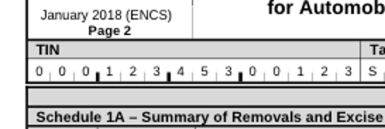
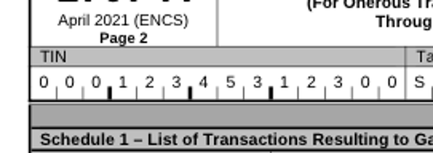
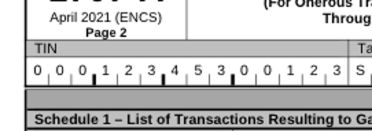
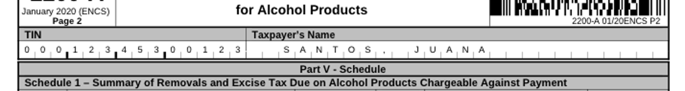
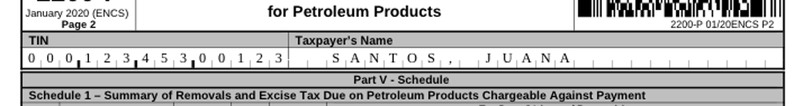
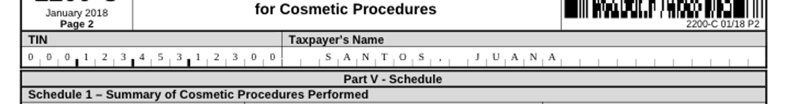
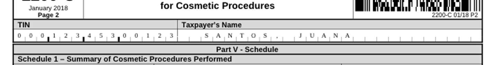
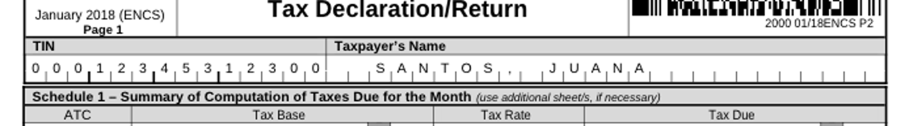

# Print TIN branch padding proof

Each crop is the page-2 TIN row for a taxpayer with TIN `000-123-453` and a
three-digit branch `123`. In the official five-box branch field that branch is
`00123`: `before-*` shows the old right-padded print output (`12300`), and
`after-*` shows the corrected left-padded output (`00123`).

The source markup for every render was produced by filling the frozen form and
then applying the application's print path exactly as the print pipeline does:

```rust
staticize(prepare_html_for(slug, filled_html, true))
```

The full staticized print HTML was generated for every form; its page-2 sheet
was then isolated only for deterministic headless rasterization and cropped
around the TIN row. The raw frozen HTML was not used directly.

| Form | Before | After |
|---|---|---|
| 2200S |  |  |
| 2200AN |  |  |
| 1707A |  |  |
| 2200A |  |  |
| 2200P |  |  |
| 2200C |  |  |
| 2000 |  |  |
