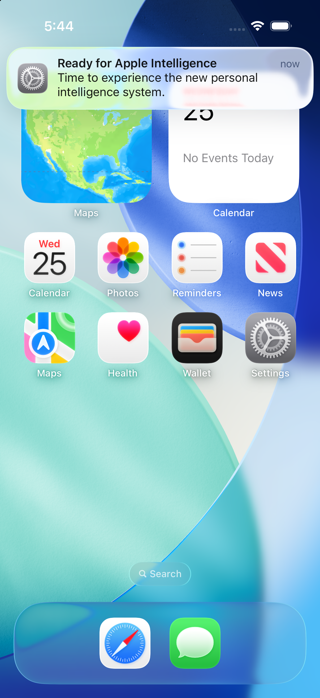

# macOS build and test machine proof

Proof that this Devin machine is ready as an eBIRForms build and test machine.
Captured on 2026-11-25 from branch `try/macos-build-machine-proof`.

## Machine

- Machine name: Apple Virtual Machine 1
- Hostname: ip-172-16-5-2.us-west-2.compute.internal
- macOS: 26.6.2 (25G83)
- Xcode: 26.6 (Build version 17F113), selected at `/Applications/Xcode.app/Contents/Developer`
- Free disk after setup and proof builds: 17 GiB
- Rust: rustc 1.99.0 (b940084d7 2026-09-28)
- Cargo: cargo 1.99.0 (5f94df478 2026-08-27)
- just: 1.59.0
- nsh: nsh 0.6.1 (8c78cfd)
- NSH pinned ref checked out in `../nsh`: `8c78cfd6d8ffcef260728ad2503d43c3bc9e86bf`

## Safety configuration

The proof commands were run with:

```sh
BUWIZ_NO_KEYCHAIN=1
EBIR_TEST_ENV=1
BIR_AUTH_BYPASS=1
BIR_SFTP_DRY_RUN=1
```

`BIR_SFTP_LIVE` was not set. The simulator commands also carried the same four values as `SIMCTL_CHILD_BUWIZ_NO_KEYCHAIN`, `SIMCTL_CHILD_EBIR_TEST_ENV`, `SIMCTL_CHILD_BIR_AUTH_BYPASS`, and `SIMCTL_CHILD_BIR_SFTP_DRY_RUN`. No return was submitted, and nothing was sent to the real BIR or the production relay.

## Proof results

| Step | Result | Log | Last lines |
| --- | --- | --- | --- |
| `bash scripts/setup-macos.sh` | PASS | [logs/setup-macos.log](logs/setup-macos.log) | `All required tooling present`; `nsh-source /Users/devin/repos/nsh at 8c78cfd`; `nsh nsh 0.6.1 (8c78cfd)` |
| Disk cleanup | PASS | [logs/disk-cleanup.log](logs/disk-cleanup.log) | `This operation has freed approximately 100.9MB of disk space.` |
| `just nsh-check` | PASS | [logs/nsh-check.log](logs/nsh-check.log) | `✓ checked nsh-app-ebirforms (50.2s)`; `✓ built the Rust crate nsh-app-ebirforms (1m 2s)` |
| `just nsh-build` | PASS | [logs/nsh-build.log](logs/nsh-build.log) | `✓ built the Rust crate nsh-app-ebirforms (876ms)`; `✓ built App.tsx into .nsh/out (1.1 MB js, 3.2 MB bytecode, 62 assets, 235ms)` |
| Boot iPhone 17 Pro simulator and `xcrun simctl io booted screenshot` | PASS | [logs/iphone-simulator.log](logs/iphone-simulator.log) | `Wrote screenshot to: /Users/devin/repos/buwiz-forms/proof/machine-setup/iphone-17-pro-screenshot.png` |

## Visual proof

Screenshot:



Screen recording: [iphone-17-pro-recording.mov](iphone-17-pro-recording.mov)

## Simulator coverage

The machine has available iOS 26.5 and iOS 27.0 runtimes. Required devices are present:

- iPhone 17 Pro (`405F45A9-B471-47B7-A5D9-E545EA624713`) — booted for the proof
- iPad Pro 13-inch (M5) (`41A2AFE3-9E35-4EE8-BEF0-21AA02B68BC3`, iOS 26.5)
- iPad Pro 13-inch (M5) (`DF9B049C-5D97-4DEB-BEA9-E63ECF1B694D`, iOS 27.0)

Complete inventories: [simctl-devices.txt](simctl-devices.txt), [simctl-runtimes.txt](simctl-runtimes.txt), [machine-info.txt](machine-info.txt).
