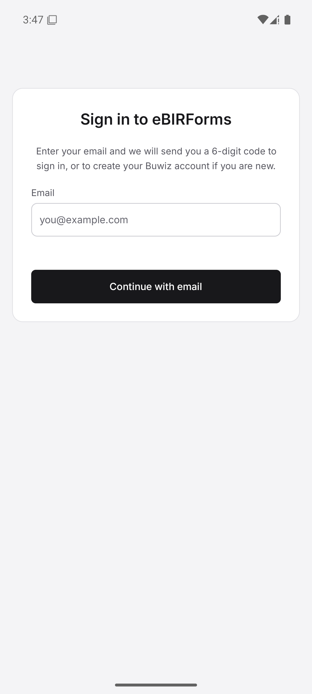

# Setup-machine proof

This proof is report-only. It was produced on the reserved forms-validation machine; no source branch was changed.

## Machine

- Machine name: `devin-box`
- OS: Ubuntu 22.04.5 LTS
- Free disk when the state file was written: 47 GB
- `/dev/kvm`: exists
- CPU virtualization flag count from `egrep -c '(vmx|svm)' /proc/cpuinfo`: 16
- Final `emulator -accel-check`: `KVM (version 12) is installed and usable.`
- Emulator boot time: 113 seconds (`emulator.log` also reports `Boot completed in 112324 ms`)
- State file for this long-lived machine: `/home/ubuntu/forms-validation/STATE.md`

The first live shell did not inherit the new `kvm` group membership even after `ubuntu` was added to the group, so the machine also has a local udev rule making `/dev/kvm` usable by the session. This is machine setup only; no repository source was changed.

## Exact revisions

- buwiz-forms setup checkout: `47ab502574b2d5f47d2eae5bbf7fa62df8a2edfc` (the main checkout used for setup and proof runs)
- NSH pinned ref required by buwiz-forms: `8c78cfd6d8ffcef260728ad2503d43c3bc9e86bf`
- NSH checkout after the pin repair: detached at `8c78cfd6d8ffcef260728ad2503d43c3bc9e86bf`
- NSH version line through the pinned wrapper: `nsh 0.6.1 (8c78cfd)`

## Proof results

| Step | Result | Evidence |
| --- | --- | --- |
| `bash scripts/setup-linux.sh --compositor` | PASS | `logs/setup-linux-compositor.log`; exit `0` |
| `bash scripts/setup-linux-nsh.sh` | PASS | `logs/setup-linux-nsh.log`; final verifier reports pinned `../nsh`, pinned CLI, NDK `27.2.12479018`, `avd:buwiz`, pinned Android runtime |
| valgrind install | PASS | `logs/apt-valgrind.log`; exit `0` |
| Android env in shell profile | PASS | `ANDROID_HOME` and `ANDROID_SDK_ROOT` are `$HOME/Android/Sdk` in `.profile` and `.bashrc` |
| `xvfb-run -a just test` | PASS after environment isolation | First inherited-environment run failed 9 child-probe tests because the VM starts with `BIR_SFTP_*` variables present (`logs/xvfb-just-test.log`). The safety-isolated rerun stripped inherited `BIR_SFTP_*` and set `BUWIZ_NO_KEYCHAIN=1 EBIR_TEST_ENV=1 BIR_AUTH_BYPASS=1 BIR_SFTP_DRY_RUN=1`; it passed (`logs/xvfb-just-test-clean-env.log`). |
| `~/BuwizNsh/nsh2404.sh nsh check` | PASS after Docker auth repair | First run could not authenticate Cargo's private git dependency inside the Ubuntu 24.04 container (`logs/nsh-check.log`). The generated wrapper was given read-only access to the VM's existing git credential store and `CARGO_NET_GIT_FETCH_WITH_CLI=true`; the rerun passed (`logs/nsh-check-authed.log`). No token was printed or stored in this proof. |
| emulator boot | PASS, KVM accelerated | `logs/emulator.log`, `logs/emulator-boot-seconds.txt`, `logs/emulator-accel-check-final.log` |
| `just mock-account` + `adb reverse tcp:3008 tcp:3008` | PASS | `logs/mock-account.log`, `logs/adb-reverse.log`; server is loopback only |
| `~/BuwizNsh/nsh2404.sh nsh run --target android --port 8792` | PASS | `logs/nsh-run-android.log`: three ABI libraries built, Android development host built and installed, emulator connected |
| first-screen screenshot | PASS | `evidence/android-first-screen.png` |
| screen recording with taps shown | PASS | `evidence/android-first-screen-pointer.mp4`; `show_touches=1` during evidence capture and pointer-location visualization was enabled only for the short recording, then switched off |

## Log tails

### `setup-linux-nsh.log`

```text
  android ndk            27.2.12479018
  avd:buwiz              present
  nsh android runtime    8c78cfd
==> NSH toolchain ready
```

### `xvfb-just-test-clean-env.log`

```text
test result: ok. 3 passed; 0 failed; 0 ignored; 0 measured; 0 filtered out; finished in 0.13s

   Doc-tests bir_submit

running 0 tests

test result: ok. 0 passed; 0 failed; 0 ignored; 0 measured; 0 filtered out; finished in 0.00s
```

### `nsh-check-authed.log`

```text
✓ checked nsh-app-ebirforms (2m 58s)
✓ built the Rust crate nsh-app-ebirforms (7m 16s)
```

### `emulator-accel-check-final.log`

```text
accel:
0
KVM (version 12) is installed and usable.
accel
```

### `nsh-run-android.log`

```text
✓ built the Rust crate nsh-app-ebirforms (6m 25s)
✓ built App.tsx (1.4 MB js, 5.2 MB bytecode, 543ms)
✓ built libnsh.so of nsh-app-ebirforms for armeabi-v7a (5m 57s)
✓ built libnsh.so of nsh-app-ebirforms for arm64-v8a (2m 16s)
✓ built libnsh.so of nsh-app-ebirforms for x86_64 (1m 59s)
✓ built the Android development host (12.3s)
✓ installed the Android development host on emulator-5554 (9.4s)
• Android Emulator (sdk_gphone64_x86_64) connected, build 1
```

## Media



Screen recording with tap/pointer visualization: [android-first-screen-pointer.mp4](evidence/android-first-screen-pointer.mp4)
